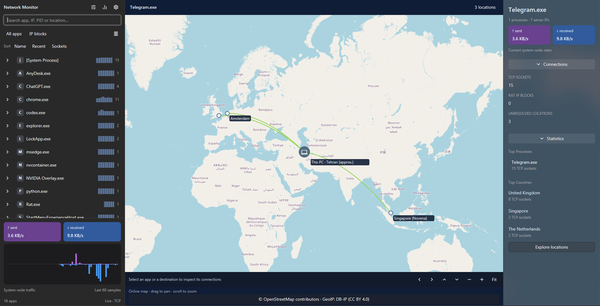
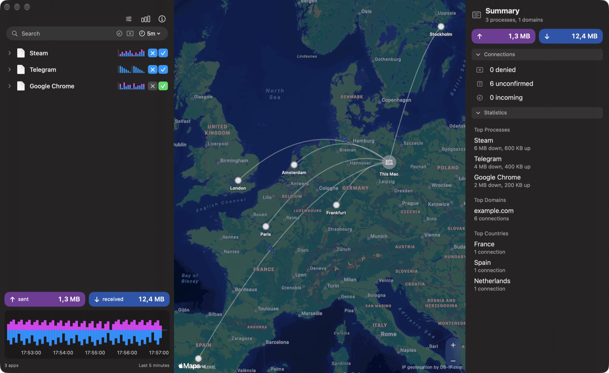
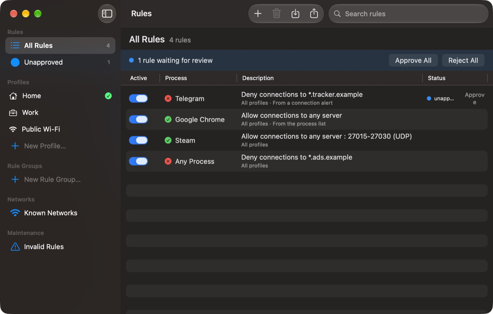
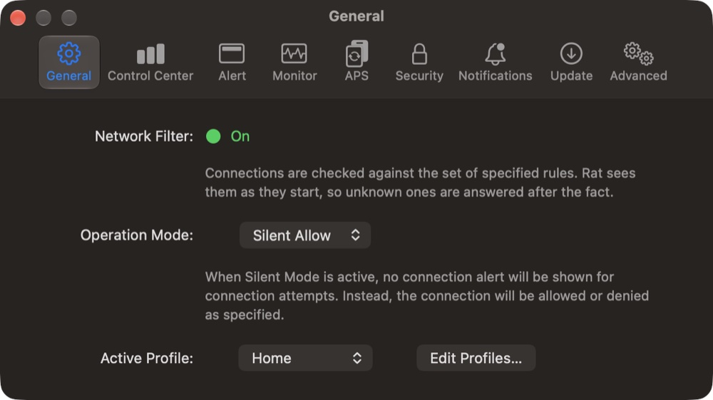

<p align="center"></p>

# Rat

**Windows Rust rewrite:** A native [GPUI Kit](https://gpui-kit.com/) desktop implementation now lives in `crates/`.
Run `cargo run --locked -p rat-desktop`. See the [Windows README](crates/README.md) and [detailed setup, features and limitations](docs/RUST_REWRITE.md),
including offline GeoIP setup and administrator requirements for directional IP blocking.



<sub>Windows Rust build. Selected-app connections are highlighted in green. The PC marker is an approximate time-zone location; traffic rates are system-wide.</sub>

The sections below describe the original macOS application.

A network monitor and application firewall for macOS, modelled on Little Snitch. Rat shows which app talks to which server (on a world map, offline), asks before unknown connections, lets you allow or deny them with rules and profiles, and blocks denied servers with the macOS packet filter.


<sub>Demo data. Server locations come from a bundled offline database; nothing leaves your Mac.</sub>

> **Honest limits.** Little Snitch intercepts each connection *before* it is made, using Apple's Network Extension entitlement, which needs a paid developer account. Rat has none, so it is **reactive**: it notices a new connection after it starts, asks, and on **Deny** cuts that app's connections by their local ports (never by server address, so other apps are not affected). A brand-new process can get its first packets out before the cut. See [docs/ARCHITECTURE.md](docs/ARCHITECTURE.md) (sections 7, 8 and 10).

## Features

- **Network Monitor** (toolbar: view options, traffic chart, inspector, as in Little Snitch): per-app list with activity sparklines, session totals, traffic chart (5m / 1h / 1d / 1w), inspector (path, code-signing ID, servers, locations), summary of top processes, domains and countries.
- **Offline world map:** server IPs are resolved on-device from a bundled DB-IP Lite database (`Contents/Resources/Vendor`). Arcs and city pins appear immediately, no lookups, no network.
- **Who runs the network:** each server shows its network owner (`AS13335 Cloudflare, Inc.`, offline, DB-IP ASN Lite), plus *Top Networks* in the Summary.
- **Your own GeoIP files** (Settings > GeoIP): pick a newer DB-IP file or a MaxMind GeoLite2/GeoIP2 City or ASN file, or download the latest DB-IP Lite. Files are validated and loaded without a restart.
- **Readable connections:** the usual service of a port (`TCP 443 · HTTPS`, `UDP 443 · QUIC`, `5223 · APN`), the process behind each connection (*via Google Chrome Helper (pid 812)*), the services in the macOS row by name (mDNSResponder, nsurlsessiond, … marked when they work for other apps), and *via VPN (Windscribe)* or *via System HTTPS Proxy* when a connection takes that path.
- **Connection alerts:** **Silent Allow** is the default, so Rat never nags on first launch. Switch to **Alert Mode** for a floating panel on unknown connections: pick the scope (*This App (Any Server)* by default, domain, exact host, port) and the lifetime (once, until quit, forever), then Allow or Deny. An app with a process-wide Allow or Deny never raises an alert, and pending alerts for it vanish.
- **Rules window** (⇧⌘R): sidebar of Rules / Unapproved / Profiles / Rule Groups / Known Networks / Invalid Rules and a table with Active, Process, Description and Status. Rules matched on app, team ID, signing ID, domain, host, IP, port range and protocol; the most specific rule wins and deny beats allow on a tie. Rule groups, profiles (Home / Work / Public Wi-Fi), **automatic profile switching** per network, **unapproved rules** with a review queue, JSON **import / export**.
- **Local proxies and SSH tunnels unmasked:** a connection through `127.0.0.1:<port>` (an `ssh -D` SOCKS tunnel, an HTTP or SOCKS proxy) shows its real destination, read from the client's proxy request on lo0 by the helper (or from `curl -x … https://host` style command lines without it), with the hop: *via ssh proxy (127.0.0.1:1080 → your server)*. The map draws This Mac → proxy server → destination. A denied app cannot leave through a local proxy or forward: its loopback connections to other programs are cut too.
- **Menu bar:** live up/down throughput, profile selector, mode switch, shortcuts.
- **Firewall enforcement:** Deny is enforced by an opt-in **background helper** (Security tab): a root LaunchDaemon, `rat-enforcerd`, that blocks the local ports of every connection of a denied app and its helpers (Chrome/Firefox/Steam helpers, Safari's WebKit networking), plus a second daemon that lists *every* process's connections so Rat also sees other users' and system processes. Rat never blocks server addresses, so other apps and DNS are never affected. Settings > Security shows what the helper is enforcing; `scripts/rat-status.sh` prints the same from a terminal. *Remove Helper* uninstalls both. Without the helper nothing is blocked and Rat sees only your own processes.
- **Updates:** *Rat menu → Check for Updates…* reads GitHub Releases.



 

## Install

Download `Rat-v1.2.0-arm64.dmg` from [Releases](https://github.com/ImanMontajabi/Rat/releases), drag Rat to Applications. Apple Silicon, macOS 14+. The app is ad-hoc signed and not notarized (no paid developer account), so the first launch needs right-click, **Open** (or `xattr -dr com.apple.quarantine /Applications/Rat.app`).

## Build

```sh
./scripts/fetch-geoip.sh                 # downloads the ~125 MB DB-IP database into App/Vendor (git-ignored)
xcodegen generate
xcodebuild -scheme Rat -configuration Release ARCHS=arm64 ONLY_ACTIVE_ARCH=YES build
xcodebuild -scheme Rat test              # app, rules-model and snapshot tests
(cd RatFilter && RAT_GEOIP_DB=../App/Vendor/dbip-city-lite.mmdb swift test)
```

Snapshot tests compare rendered SwiftUI views with goldens in `AppTests/Snapshots` and check layout and colour against the Little Snitch reference screenshots (kept local in `./screenshot`). Re-record goldens with `TEST_RUNNER_RAT_RECORD_SNAPSHOTS=1`.

## Layout

| Path | Contents |
|---|---|
| `RatFilter/Sources/RatFilterCore` | Rules, profiles, groups, network triggers, engine, import/export. Pure Swift. |
| `RatFilter/Sources/RatMonitor` | `libproc` connection sampler, `nettop` traffic sampler, root-snapshot parser, port names, VPN and system-proxy detection. |
| `RatFilter/Sources/RatGeo` | MaxMind DB (`.mmdb`) reader (City and ASN, hardened for user-chosen files) and time-zone locator. |
| `RatFilter/Sources/RatFilterExtension` | `NEFilterDataProvider` from the first prototype. Dormant: it needs the Network Extension entitlement. |
| `App/` | SwiftUI app: monitor, rules window, alert panel, menu bar, pf enforcer. |
| `App/Resources/rat-pf-helper.sh` | The helper that runs as root (`apply` / `snapshot`). Validates every address it reads. |

## Where the design comes from

Static reverse-engineering of the installed Little Snitch (with [REA](https://github.com/morluto/rea)): a `NEFilterDataProvider` content filter with allow / drop / pause verdicts, rules re-applied to live flows, matching by code signature, an *unapproved* rule state, profiles with network triggers, a separate agent for alerts, and an Endpoint Security extension. No Little Snitch code or assets are used. The screenshots below are of Little Snitch and are UI reference only.

| | |
|---|---|
|  |  |
|  |  |

## Credits and license

MIT, see [LICENSE](LICENSE). IP geolocation and network data by [DB-IP.com](https://db-ip.com), IP to City Lite and IP to ASN Lite databases, licensed [CC BY 4.0](https://creativecommons.org/licenses/by/4.0/).
