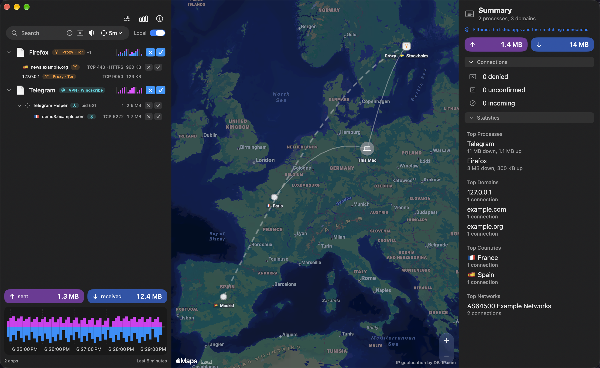
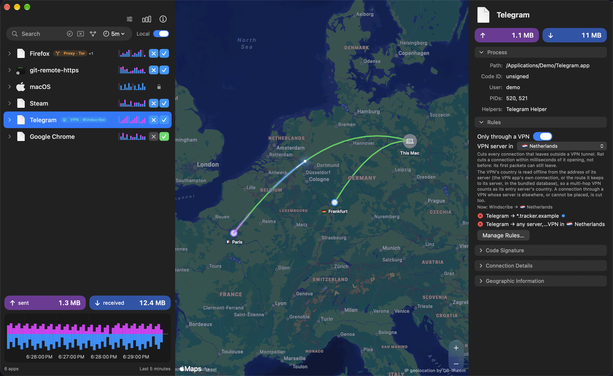
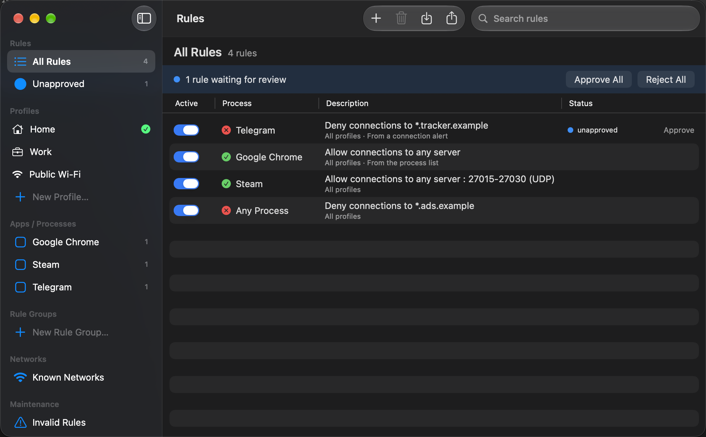
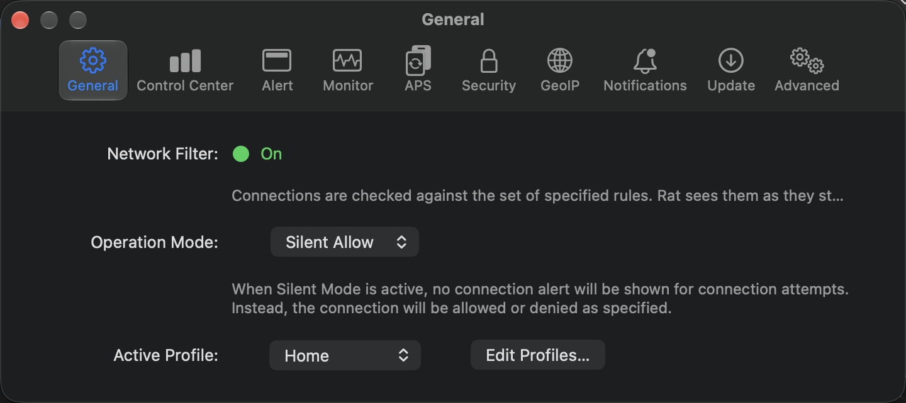
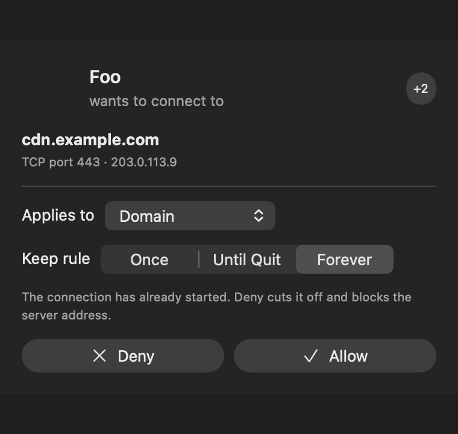
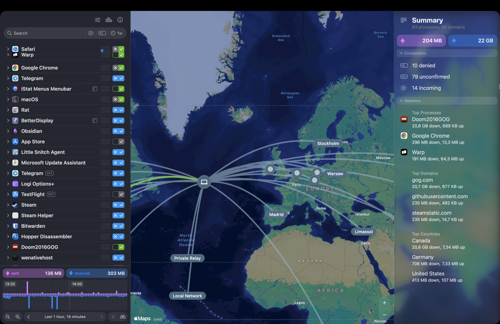
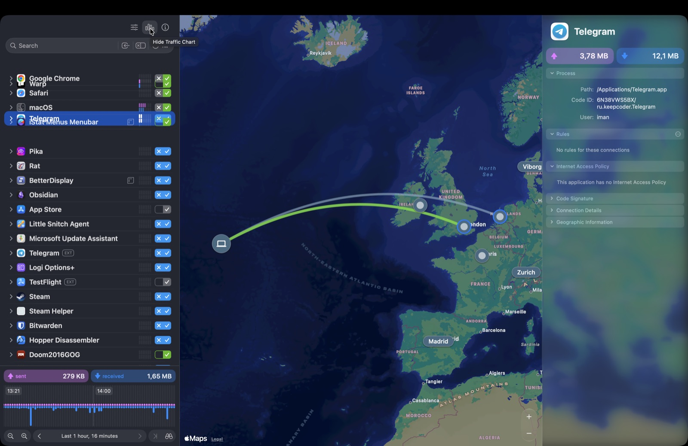
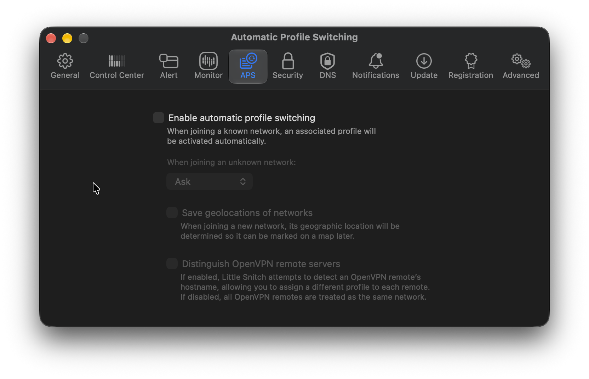
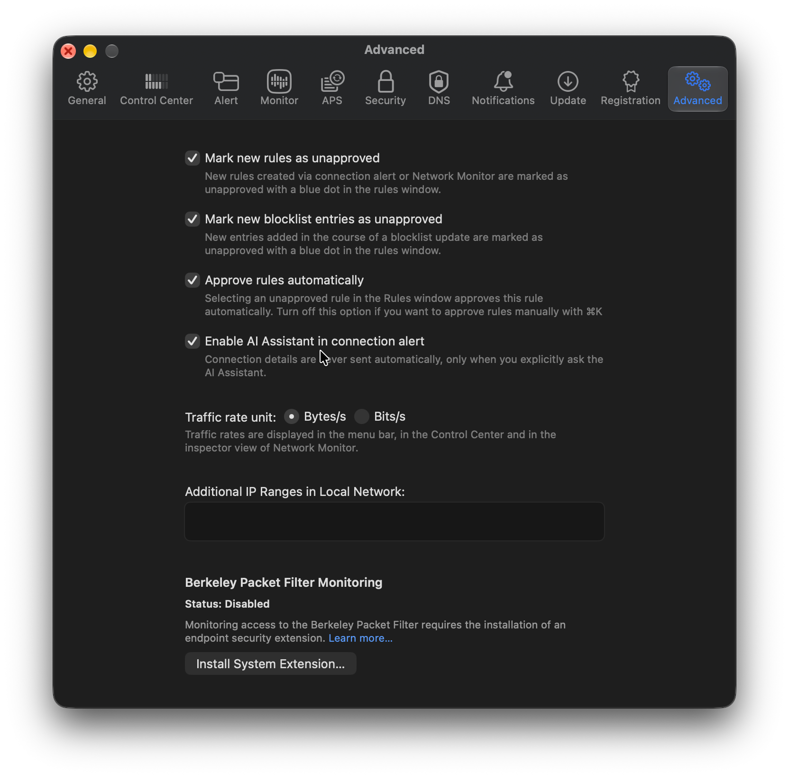

<p align="center"></p>

<h1 align="center">Rat</h1>

<p align="center">
🇬🇧 English | <a href="./README.fa.md">🇮🇷 فارسی (Persian)</a>
</p>

<p align="center">
<a href="https://github.com/ImanMontajabi/Rat/releases/latest"></a>
<a href="https://github.com/ImanMontajabi/Rat/releases"></a>
<a href="https://github.com/ImanMontajabi/Rat/actions/workflows/ci.yml"></a>

<a href="LICENSE"></a>
</p>

Rat is a network monitor and application firewall for macOS, modelled on Little Snitch. It shows which app, and which of its processes, talks to which server, on an offline world map. It shows which connections go through a VPN or a proxy, and unmasks the real destination behind local proxies and SSH tunnels. You can deny a whole app, one of its processes or a single connection, and Rat cuts it off with the macOS packet filter. You can also keep an app on your VPN (optionally a VPN in one country) and write rules for the servers in a country. Rat is free and open source (MIT), with no trial and no paywall.


<sub>Demo data. The monitor is filtered to *Through a VPN or Proxy*: Telegram is opened down to its helper's connection through Windscribe, and Firefox's connections go through `ssh -D` and Tor. Every row has its own ✗/✓, and connections show their country's flag. The map draws This Mac → proxy server (Stockholm) → real destination (Madrid), and the Summary counts only what the filter leaves. Server locations come from a bundled offline database; nothing leaves your Mac.</sub>

> **Honest limits.** Little Snitch intercepts each connection *before* it is made, using Apple's Network Extension entitlement, which needs a paid developer account. Rat has none, so it is **reactive**: it notices a connection after it starts, and cuts a denied app's connections by their local ports. A brand-new process can get its first packets out before the cut. The app is ad-hoc signed and not notarized. See [docs/ARCHITECTURE.md](docs/ARCHITECTURE.md) (sections 7, 8 and 10).

## New in 1.6

- **[Only through a VPN](#only-through-a-vpn):** an app, or one of its processes, keeps working only through a VPN tunnel. Its connections outside the tunnel are cut within milliseconds.
- **[A VPN in one country](#only-through-a-vpn):** *Only through a VPN in 🇩🇪 Germany* also cuts its connections through a VPN that leads elsewhere. Rat finds the VPN's server offline, WireGuard included.
- **[Rules for a country](#rules-for-a-country):** deny or allow the servers in one country, picked by its flag.
- **A labeled Local switch** beside the search field hides LAN and Bonjour traffic. Traffic on the map moves as laser tracers, and the inspector lists a row's rules without repeating its ✗/✓.

Every release's notes are in [CHANGELOG.md](CHANGELOG.md) and on the [releases page](https://github.com/ImanMontajabi/Rat/releases).

## What makes Rat different

### Process tree, three levels deep
Expand an app to see its direct connections and its helper and child processes, then expand a process to see its connections. Examples are `com.apple.WebKit.Networking` under Safari, `Google Chrome Helper` under Chrome, `steam_osx` under Steam, and services such as `mDNSResponder` and `nsurlsessiond` under macOS (marked when they work for other apps). Every process and every connection has its own traffic counters and its own ✗/✓: deny or allow the whole app, one of its processes, or one connection (that process, server, port and protocol). The narrowest choice decides, and a row that has none shows the one it follows, muted. For a command-line tool, the inspector shows which app started it (*Started by Warp*), but its rules stay its own.

### The real destination behind local proxies and SSH tunnels
With `http_proxy`, `https_proxy`, `ALL_PROXY`, an `ssh -D` SOCKS tunnel, or a local v2ray/Xray/Clash/sing-box proxy, socket-based monitors usually see only `127.0.0.1:<port>` and the proxy's one connection to its server. Rat shows **both**:
- **the hop**, for example *via ssh proxy (127.0.0.1:1080 → your server)*;
- **the real destination**: its domain, address, network owner and location on the map.

With the helper installed, Rat reads the opening request a program sends to a proxy on loopback (HTTP `CONNECT`, plain HTTP, SOCKS5, SOCKS4/4a), and never the traffic after it. Without the helper, it reads the proxy settings in a program's command line and environment, such as `curl -x … https://host`.

### VPN and proxy tags on every level
Rat detects active tunnels (`utun*`: Windscribe, WireGuard, OpenVPN, Cloudflare WARP, Tailscale, Mullvad, …) and names each one after the app that owns it. It also detects the system proxy and local proxies such as ssh, Tor and Clash.

Apps, processes and connections get badges such as `VPN · Windscribe`, `Proxy · ssh` or `VPN server · Windscribe` (the VPN client's own connection to its server). A connection counts as tunnelled when its socket is bound to the tunnel's address, or, when it has no address of its own, when the routing table sends it into the tunnel. No packets are inspected. To filter, use the route chip or type `vpn` or `proxy` in the search.

### Only through a VPN
Switch on **Only through a VPN** in the inspector for an app or one of its processes, or add the condition to a rule in the Rules window. The app keeps working through the VPN; every connection it makes outside a tunnel (the VPN is off or has dropped, a split tunnel leaves that server out, or a socket was opened on Wi-Fi before the VPN came up) is cut, whatever ✓ the app has. Connections inside the local network are left alone. The daemon checks the tunnels five times a second and the app's sockets every 3 ms. It is a fast cut, not a gate: Rat cannot hold a connection before it opens (no Network Extension), so the first packets of a connection outside the VPN can still leave. A connection through a local proxy follows the proxy's route: switch it on for the proxy program too.

You can also pick the VPN's country under the switch (or in the rule editor): **Only through a VPN in 🇩🇪 Germany** keeps the app working only while its traffic goes through a tunnel to a server in Germany. Rat finds the server from the VPN app's own connection (its local relay in a stealth mode, or for WireGuard the route the VPN app keeps to its server) and places it with the bundled offline database, so a multi-hop VPN counts as its entry server's country. When the VPN moves to another country, or its server cannot be placed, the app's connections through it are cut too. The inspector shows where your VPN leads now.


<sub>Demo data. Telegram is allowed only through a VPN in 🇳🇱 the Netherlands. The inspector shows the switch, its country picker, and where the Windscribe tunnel leads now.</sub>

### Rules for a country
A rule can name the servers in one country: deny or allow an app, one of its processes or any process the servers that the bundled offline database places in, say, 🇩🇪 Germany. Pick the country in the Rules window's editor, or start the rule from a connection's inspector (**Rule for Servers in 🇩🇪 Germany…**) or from a country's header when the list is grouped by country. A deny for a country holds over the app's ✓; a more specific rule, such as one domain, still decides over it. Servers in the local network, loopback and addresses the database does not know are in no country, so a country rule never touches them. The helper reads the same database file as the map and judges every socket of the app on its 3 ms pass, so both find the same country; nothing is looked up online. Like every Rat rule it cuts a connection once it has opened, by its local port, never the server's address.

### Blocking that leaves DNS alone
Deny is enforced by `rat-enforcerd`, an opt-in root daemon:
- **How it blocks:** it blocks the **local ports** of the denied sockets with stateless `pf` rules (`block return-rst` for TCP, `block return-icmp` for UDP, inbound dropped): every socket of a denied app and its helpers, or only those of a denied process or connection, which the daemon judges itself.
- **How fast:** a deny takes effect on the daemon's next pass, even when nothing was denied before, and it re-reads the denied processes' sockets every 3 ms while one is running.
- **What it never touches:** server addresses. Shared resolvers such as `1.1.1.1` and `8.8.8.8`, and every app you allow, keep working.
- **Proxies and forwards:** a denied app cannot slip out through a local proxy or an `ssh -L` forward, because its loopback connections to other programs are cut too.

### One monitor, three synchronized panes
- **Left:** the app list with sparklines, session totals and a 5m / 1h / 1d / 1w traffic chart.
- **Middle:** the world map, drawing only what the list shows. Busy connections show their traffic moving, purple for sent and blue for received, only while the window is visible and Reduce Motion is off.
- **Right:** the inspector for the selected app, process or connection, or a Summary of top processes, domains, countries and networks that follows the search and filters.
- **Local switch:** the Local switch beside the search field hides local-network traffic (the LAN, multicast and Bonjour) in the list, the map and the Summary when turned off, and Rat remembers it.

### Everything else
- **Connection alerts:** **Silent Allow** is the default, so a fresh install never nags. **Alert Mode** shows a floating panel for unknown connections, with a scope (app, domain, host, port) and a lifetime (once, until quit, forever).
- **Rules window** (⇧⌘R):
  - **Rules:** match on app, one of its processes, team ID, signing ID, domain, host, IP, the server's country, port range and protocol, with an optional **Only through a VPN** condition (any VPN, or a VPN in one country). The most specific rule wins, and deny beats allow on a tie.
  - **Organizing:** rule groups, profiles (Home / Work / Public Wi-Fi) with automatic switching per network, and unapproved rules with a review queue.
  - **Sharing:** JSON import and export.
- **Readable connections:** the usual service of each port (`TCP 443 · HTTPS`, `UDP 443 · QUIC`, `5223 · APN`), the network owner (`AS13335 Cloudflare, Inc.`), the country's flag and place (*🇩🇪 Berlin, Germany*), and reverse DNS that never holds up the monitor.
- **Direction:** a peer's connections to a port on this Mac are a row of their own, tagged `↓ Incoming` (judged by the rules, never an alert). A long download that is still receiving is tagged `↓ stream`.
- **Offline GeoIP:** bundled DB-IP Lite City and ASN databases. You can also use your own DB-IP or MaxMind file (Settings > GeoIP).
- **Menu bar:** live throughput, a profile selector and a mode switch.
- **Updates:** *Rat menu → Check for Updates…* reads GitHub Releases.

| Rules window (⇧⌘R) | Settings (⌘,) |
|---|---|
|  |  |

Settings has ten tabs, named as in Little Snitch: General, Control Center, Alert, Monitor, APS, Security, GeoIP, Notifications, Update and Advanced.



## Install

1. Download `Rat-v<version>-arm64.dmg`. **Stable:** from [the latest release](https://github.com/ImanMontajabi/Rat/releases/latest). **Nightly:** from [the pre-releases](https://github.com/ImanMontajabi/Rat/releases), built from `main` on every merge (the newest five are kept). Each DMG has a `.sha256` next to it: `shasum -a 256 -c Rat-*.dmg.sha256`.
2. Open the DMG and drag Rat to Applications. Rat needs an Apple Silicon Mac with macOS 14 or later.
3. Rat is ad-hoc signed and not notarized (there is no paid developer account), so open it the first time with right-click → **Open**, or run:
   ```sh
   xattr -dr com.apple.quarantine /Applications/Rat.app
   ```
4. **Install the firewall helper (optional).** Open Settings (⌘,) → **Security** → **Install Helper…** and enter your administrator password. This installs two root LaunchDaemons:
   - `rat-enforcerd`, which enforces Deny and reads proxy requests on loopback;
   - a snapshot helper, so Rat also sees other users' and system processes.

   After an update, the same tab offers **Update Helper…**, and **Remove Helper…** uninstalls both. Without the helper, Rat still monitors your own processes, but nothing is blocked.

To see what is enforced right now, run `scripts/rat-status.sh`, or `sudo scripts/rat-status.sh` to include the live `pf` rules.

## Build from source

Requirements: Xcode (newest stable) and [XcodeGen](https://github.com/yonaskolb/XcodeGen) (`brew install xcodegen`). `create-dmg` is optional; `make-dmg.sh` falls back to `hdiutil`.

```sh
./scripts/fetch-geoip.sh                    # once: the ~125 MB DB-IP databases into App/Vendor (git-ignored)
xcodegen generate                           # Rat.xcodeproj is generated from project.yml
./scripts/build-release.sh /tmp/out         # the Release build CI makes → /tmp/out/Rat.app
./scripts/make-dmg.sh /tmp/out/Rat.app /tmp/out/Rat.dmg
```

## Architecture

| Module | Contents |
|---|---|
| `App/` | The SwiftUI app. `Ledger` samples every 1.5 s, groups processes into apps, evaluates each connection against the rules, raises alerts and hands the helper the denied apps and ports. It also holds the monitor, the Rules and Settings windows, the alert panel and the menu bar. |
| `RatFilter/Sources/RatFilterCore` | The rule engine: rules (with the VPN and country conditions), profiles, groups, network triggers, import/export. Pure Swift. |
| `RatFilter/Sources/RatMonitor` | The `libproc` connection sampler, the `nettop` traffic sampler, process grouping, port names, and VPN, route and proxy detection (routing socket, tunnel owners and where each tunnel leads, system proxies, command-line proxy settings). |
| `RatFilter/Sources/RatGeo` | A MaxMind DB (`.mmdb`) reader (City and ASN; hardened for files you choose) and the time-zone locator. |
| `RatFilter/Sources/RatEnforce` + `Enforcerd/` | `rat-enforcerd`, the root daemon: the `pf` anchor for denied sockets' local ports, the rules it follows on its 3 ms pass (one process, one connection, Only through a VPN, countries), and the loopback proxy-request reader (BPF on `lo0`). It never blocks remote addresses. |
| `RatFilter/Sources/RatFilterExtension` | A dormant `NEFilterDataProvider` that needs the Network Extension entitlement. |

The full design, including why Rat blocks local ports and not addresses, is in [docs/ARCHITECTURE.md](docs/ARCHITECTURE.md).

## Testing

```sh
xcodebuild -scheme Rat test                                            # app, rules-model and snapshot tests
(cd RatFilter && RAT_GEOIP_DB=../App/Vendor/dbip-city-lite.mmdb swift test)   # the packages
scripts/test-ui.sh                  # XCUITest on demo data + snapshot goldens (needs a logged-in GUI session)
scripts/readme-screenshots.sh       # retakes the screenshots above from demo data
sudo scripts/verify-blocking.sh     # live end-to-end blocking test
```

The UI tests and screenshots run a separate demo build (bundle ID `com.imanmontajabi.Rat.uitest`) with fixed data. They never touch your running Rat, its rules or its preferences. Keep your hands off the keyboard and mouse while they run.

## Release workflow

- **Pull requests:** every change goes through a PR into `main` from a `feat/`, `fix/`, `ci/`, `test/` or `docs/` branch, and adds a fragment in [`changelog.d/`](changelog.d/README.md) (`scripts/changelog.py new <type> <slug> "…"`). CI checks the fragment and the `Version` file, runs the tests, and builds a DMG.
- **Version:** the root `Version` file (`X.Y.Z`) is the version being developed. `scripts/version.sh set X.Y.Z` keeps `project.yml` in step.
- **Nightly:** every merge into `main` publishes `v<Version>-nightly.<date>.<sha>` as a pre-release with its DMG and notes.
- **Stable:** a PR from `main` into `release`, merged with a merge commit so the two branches keep sharing history, publishes `v<Version>`. The workflow then opens a PR back to `main` that compiles the fragments into [CHANGELOG.md](CHANGELOG.md) and bumps `Version`.

## Where the design comes from

The design comes from static reverse engineering of the installed Little Snitch (with [REA](https://github.com/morluto/rea)). It found:
- a `NEFilterDataProvider` content filter with allow, drop and pause verdicts, and rules re-applied to live flows;
- matching by code signature, and an *unapproved* rule state;
- profiles with network triggers;
- a separate agent for alerts, and an Endpoint Security extension.

No Little Snitch code or assets are used. The screenshots below are of Little Snitch and are UI reference only.

| | |
|---|---|
|  |  |
|  |  |

## Credits and license

MIT, see [LICENSE](LICENSE). IP geolocation and network data come from [DB-IP.com](https://db-ip.com): the IP to City Lite and IP to ASN Lite databases, licensed [CC BY 4.0](https://creativecommons.org/licenses/by/4.0/).
